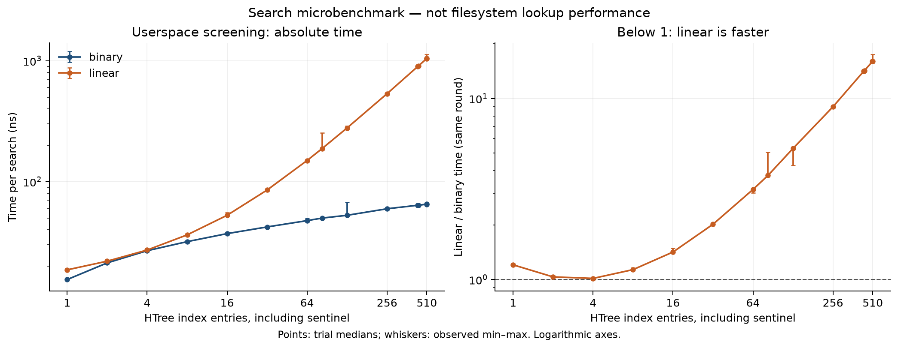
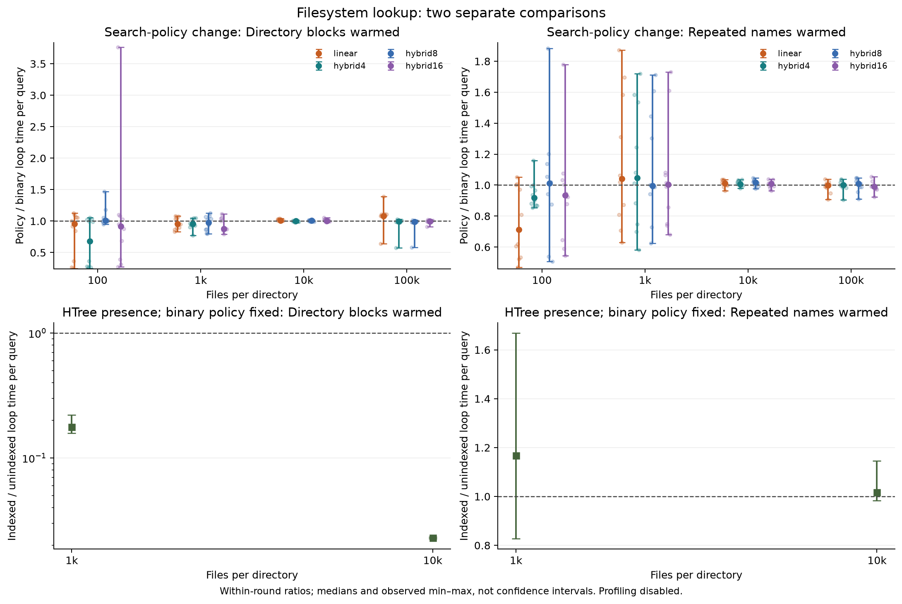
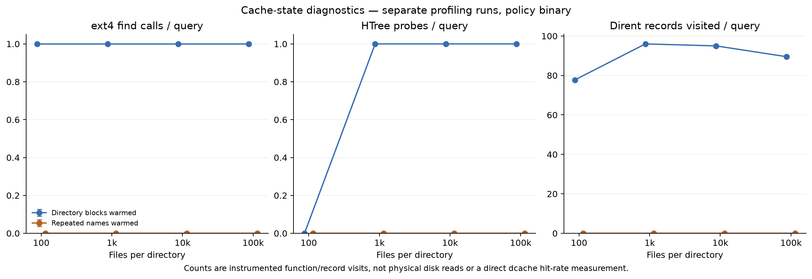
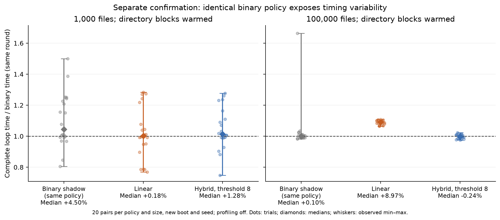

# ext4 HTree 탐색 실험

Linux 5.4.214에서 디렉터리 이름 검색에 쓰는 HTree 인덱스 탐색을 비교한다.
기존 이진 탐색, 선형 탐색, 노드의 엔트리 수에 따라 전환하는 혼합 탐색이 대상이다.

2026-11-18에 Ubuntu VM에서 커널 빌드·부팅과 측정을 완료했다. **이번 조건에서는 하이브리드 탐색의 명확한 조회 성능 개선을 확인하지 못했다.** 큰 디렉터리의 순수 선형 탐색은 두 번의 부팅 세션에서 더 느렸다.

## 질문

작은 HTree 노드에서 선형 탐색이 유리한가? 그 차이가 실제 파일 이름 검색에서도 보이는가?

`dx_probe()`가 블록을 선택하는 부분만 바꾼다. HTree 자체를 교체하거나 디스크 형식을 변경하는 실험은 아니다. 선택한 leaf 블록 안의 가변 길이 디렉터리 엔트리 검색과 dentry 캐시는 별도의 단계다.

## 비교

| 방식 | 동작 |
| --- | --- |
| binary | 원본과 같은 이진 탐색 |
| linear | 첫 엔트리부터 순서대로 탐색 |
| hybrid4/8/16 | 엔트리가 임계값 이하일 때만 선형 탐색 |

검색 함수의 정확성을 검사하고, 실제 커널 조회·별도 경로 계측·탐색 함수 마이크로벤치마크를 수행했다. 시간 측정에서는 계측을 끈다. dentry 캐시가 적중해 ext4를 건너뛰는 결과를 별도로 구분한다.

## 결과

실제 조회의 주 지표는 `fstatat` 조회 루프 전체 시간을 질의 수로 나눈 값이다. 변화율은 같은 round의 정책/binary 비율을 구한 뒤 중앙값을 계산했다. 아래는 디렉터리 목록만 먼저 읽은 `warmdir` 조건이다.

| 디렉터리 파일 수 | 정책 | 1차 10회 | 별도 부팅 추가 20회 |
| ---: | --- | ---: | ---: |
| 10,000 | linear | +1.21% (10/10회 느림) | 측정 안 함 |
| 100,000 | linear | +8.47% (9/10회 느림) | **+8.97% (20/20회 느림)** |
| 100,000 | hybrid8 | −0.82% | −0.24% (11/20회 빠름) |

추가 확인의 100,000개 조건에서 linear 변화율 범위는 +6.47~+10.85%였다. hybrid8은 −2.46~+2.34%였으며, 같은 이진 탐색에 이름만 달리 붙인 대조군(binary_shadow)의 중앙값도 +0.10%였다. 작은 차이만으로 하이브리드의 이득을 주장하지 않는다.

100·1,000개 조건은 변동이 컸다. 100개에서는 HTree에 들어가지 않는데도 정책 라벨별 시간 차이가 있었고, 추가 확인의 1,000개 조건에서는 같은 이진 탐색 대조군도 +4.50%(범위 −19.49~+50.06%) 차이를 보였다. 기존 자료를 버리거나 대체하지 않았으며, [1차 전체 비율](analysis/paired_summary.csv)과 [추가 확인](analysis/confirmation_paired_summary.csv)을 함께 남겼다.

마이크로벤치마크에서도 선형 탐색의 중앙값 이득은 없었다. count 8은 binary 31.82 ns / linear 36.21 ns, count 436은 63.68 ns / 895.78 ns였다. 이 값은 사용자 공간의 탐색 함수 비교이고 커널 함수의 기계어·전체 파일 조회 시간을 직접 나타내지 않는다.

계측으로 확인한 내용:

- 이름을 먼저 조회한 `warm` 조건은 모든 계측 실행에서 ext4 검색 진입이 0이었다. 이 조건의 시간 차이를 HTree 패치 효과로 해석하지 않는다.
- 100개 디렉터리는 HTree를 사용하지 않았다. 1,000개는 count 8, 10,000개는 83, 100,000개는 루트 count 2와 하위 count 436·442였다.
- 100,000개 조건의 hash 비교 수는 binary 196,717회, linear 4,453,768회였다(질의 20,000개). leaf 방문 수는 같았고 선택 엔트리 불일치는 0이었다. 비교 횟수는 CPU 시간 비중이 아니다.
- HTree 유무 대조에서 10,000개 디렉터리의 indexed/unindexed 시간 비율은 약 0.023(약 43.5배의 속도 비율)이었다. **기존 HTree의 효과이며 이번 패치로 얻은 개선이 아니다.**

## 검증과 범위

- 원본 B0와 패치 커널을 실제로 부팅했다. 설정 차이는 `CONFIG_LOCALVERSION` 한 줄이다.
- 실제 패치에서 추출한 함수는 527,360개 질의를 ASan·UBSan과 함께 통과했다. 별도 모델 검사는 2,717,952개 질의를 통과했다.
- 1차: 원본 80회, 패치 400회, 인덱스 유무 대조 48회, 별도 계측 40회. 추가 확인: 160회. 조회 오류·계측 불일치는 모두 0이었다.
- 두 indexed 디렉터리(각 1,200개 파일)에서 다섯 정책 × 9개 변경 단계와 초기 상태를 검사했다. 이름·inode·링크 수·내용 검사를 통과했고, 이미지 분리 후 fsck도 통과했다.
- VirtualBox, 2 vCPU, 3.8 GiB RAM, Linux 5.4.214, ext4 4 KiB 블록, 단일 프로세스 실험이다. 물리 디스크의 완전한 cold I/O나 동시성 성능을 검증한 실험은 아니다.

이번 후보가 기존 주제를 교체할 만큼의 개선을 보였다고 판단하지 않는다. HTree를 발표 주제로 삼는다면, 검색 구조·캐시가 바꾸는 실행 경로·최적화 시도의 한계를 설명하는 방향이 현재 근거에 맞는다. leaf 검색 개선이나 다른 자료구조의 가능성까지 배제한 결과는 아니다.

## 재현과 자료 읽기

- [재현 명령](docs/reproduce.md)
- [사전 실험 계획](docs/experiment-plan.md), [추가 확인 계획](docs/confirmation-plan.md)
- [커널 변경과 계측 의미](docs/kernel-change.md), [벤치마크 프로토콜](docs/bench-protocol.md)
- [분석 실행 방법](analysis/README.md), [1차 해석](analysis/interpretation.md), [추가 확인 해석](analysis/confirmation-interpretation.md)

원자료는 `results/`, 집계와 그림은 `analysis/`에 있다. 질의별 지연 CSV는 gzip으로 압축했고, 로그의 접속 계정·호스트 표시는 치환했다. 측정값과 질의는 변경하지 않았다.

## 구성

- `patches/`: Linux 5.4.214에 적용할 패치
- `bench/`: 검색 및 파일 조회 벤치마크
- `scripts/`: 실험용 파일 생성과 측정
- `results/`: 실행 환경, 설정, 원자료
- `analysis/`: 집계와 그림
- `docs/`: 설계와 재현 방법

커널 전체 소스와 실험용 디스크 이미지는 포함하지 않는다.

## 기준 소스

- [Linux v5.4.214 ext4/namei.c](https://github.com/gregkh/linux/blob/v5.4.214/fs/ext4/namei.c)
- [Linux 5.4 pathname lookup](https://www.kernel.org/doc/html/v5.4/filesystems/path-lookup.html)

실험은 AI 도구로 구현·실행했다. 팀 발표 전에는 각자 패치와 결과를 읽고 설명할 수 있는 범위를 확인한다.
